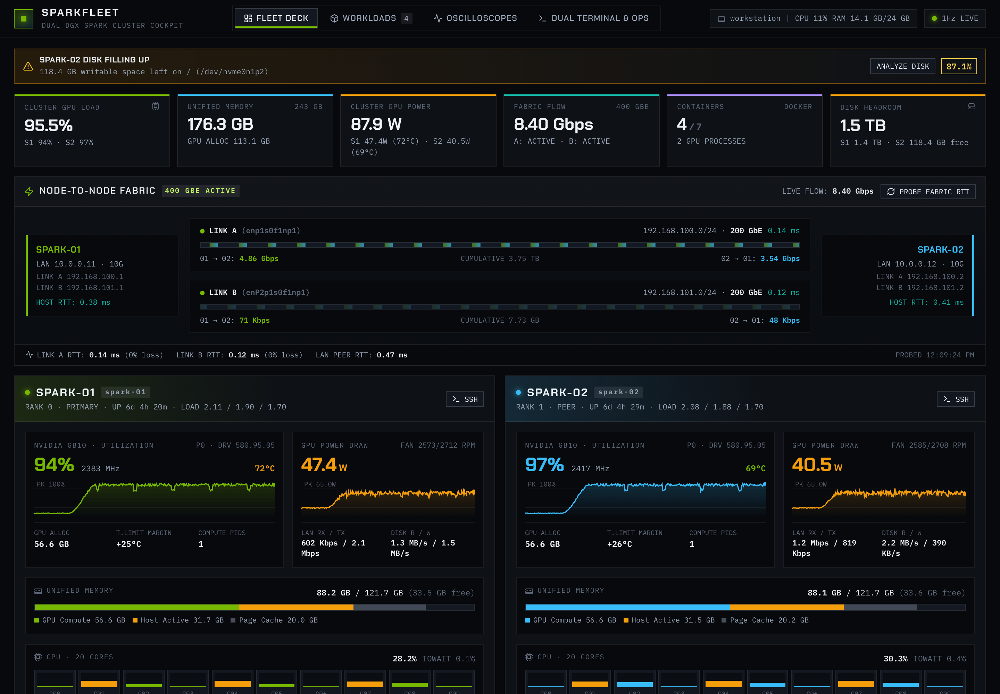
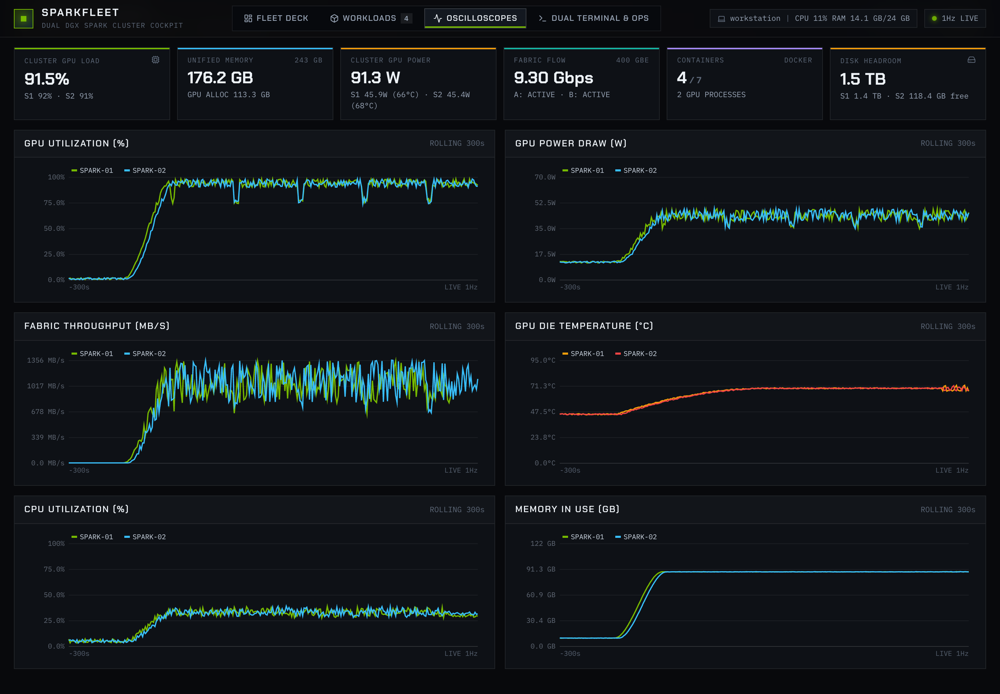

# SparkFleet

A dashboard for your NVIDIA DGX Sparks that runs on your own computer. It works with **one to eight Sparks** and shows them all on one page: GPU load, memory, temperatures, disks, network links, Docker containers and a terminal for each machine.

SparkFleet runs on a Mac or Linux computer and reaches each Spark over SSH. Nothing is installed on the Sparks, and it only connects to the machines you list.


## What you can do with it

- **Watch every Spark live.** GPU load, power draw, temperature, fan speed, CPU use per core and the processes using GPU memory, updated once a second.
- **See where memory goes.** GPU allocations, programs, file cache and swap on each Spark.
- **Check the links between Sparks.** Each high-speed link shows whether it is up, its speed, how much data is flowing each way and its latency.
- **Get warned early.** Alerts appear when a disk is nearly full, a GPU runs hot, memory is nearly used up or a Spark stops responding.
- **Manage Docker containers.** List the containers on every Spark, read their logs, and start, stop or restart them.
- **Compare Sparks over time.** Charts cover the last five minutes of GPU load, power, temperature, CPU, memory and link traffic, with one line per Spark.
- **Run commands.** Send one command to some or all Sparks and read each result side by side, or open a terminal on any Spark.

## How many Sparks?

Any number from one to eight. You list your Sparks in a small settings file, one line each, and the dashboard lays itself out to match. There is nothing else to set.

| You have | What you get |
|---|---|
| 1 Spark | Everything except the link view, which needs a second Spark |
| 2 Sparks | Both Sparks side by side, plus the links between them |
| 3 to 8 Sparks | Every Spark, and every link between them, however they are cabled: direct cables, a ring, a full mesh or a shared switch |


## Try it first, without any Sparks

You can see the whole dashboard with simulated Sparks. Install [Bun](https://bun.sh), then:

```bash
bun install
bun run demo      # two simulated Sparks
bun run demo:8    # eight simulated Sparks
```

Open the link it prints (it starts with `http://127.0.0.1:7799/auth`). The demo makes no network connections; the numbers, logs and terminal output are made up.

## What you need

- **A Mac or Linux computer** with [Bun](https://bun.sh) 1.3 or newer. It also uses the `ssh` and `ping` commands, which both systems normally include.
- **SSH access to each Spark without typing a password.** If `ssh my-spark-1 hostname` prints the Spark's name without asking you anything, you are set. If you use NVIDIA Sync, the names it created work as they are.
- **Nothing extra on the Sparks.** SparkFleet uses tools that ship with DGX OS (`python3`, `nvidia-smi`, `docker`, `bash`).

## Set it up

1. **Install.**
   ```bash
   bun install
   ```

2. **List your Sparks.** Copy the example settings file:
   ```bash
   cp sparkfleet.config.example.json sparkfleet.config.json
   ```
   Open `sparkfleet.config.json` and replace `my-spark-1` with the name you use to SSH into your Spark. That is all a single Spark needs:
   ```json
   {
     "nodes": {
       "spark-0": { "sshHost": "my-spark-1" }
     }
   }
   ```
   For more Sparks, add one line each. The keys go from `spark-0` up to `spark-7`:
   ```json
   {
     "nodes": {
       "spark-0": { "sshHost": "my-spark-1" },
       "spark-1": { "sshHost": "my-spark-2" },
       "spark-2": { "sshHost": "my-spark-3" }
     }
   }
   ```

3. **Start it.**
   ```bash
   bun run start
   ```

4. **Open the link it prints.** It looks like `http://127.0.0.1:7700/auth?token=...`. Opening it once unlocks the dashboard in that browser. Each time you start SparkFleet it prints a new link.

To add or remove a Spark later, edit the file and start SparkFleet again. Your settings file is never uploaded: Git ignores it.

### If a Spark shows as offline

- Run `ssh -o BatchMode=yes my-spark-1 hostname` yourself. SparkFleet needs this to work without a password prompt or a "do you trust this host" question. Connecting once by hand answers that question for good.
- Check the name in `sparkfleet.config.json` for typos. Each Spark needs its own, different name.
- The alert at the top of the dashboard shows the error SSH reported.

## Screenshots

| Fleet deck | Workloads |
|---|---|
|  |  |

| Comparison charts | Commands and terminals |
|---|---|
|  |  |

Every image on this page comes from `bun run demo` and `bun run demo:8`, which use simulated Sparks, not a real cluster.

## Settings

Only `sshHost` is required. Everything else has a default.

| Setting | In the settings file | As an environment variable | Default |
|---|---|---|---|
| SSH name of a Spark | `nodes.spark-N.sshHost` | `SPARKN_HOST` | none; you must set it |
| Name shown on its card | `nodes.spark-N.label` | `SPARKN_LABEL` | `SPARK-01` to `SPARK-08` |
| Subtitle on its card | `nodes.spark-N.role` | `SPARKN_ROLE` | `DGX SPARK` |
| Color of its card and chart line | `nodes.spark-N.accent` (`#RRGGBB`) | | one color per Spark |
| Port the dashboard uses | `port` | `SPARKFLEET_PORT` | `7700` |
| Location of the settings file | | `SPARKFLEET_CONFIG` | `./sparkfleet.config.json` |
| Keep the same access link between starts | | `SPARKFLEET_TOKEN` (24 or more characters) | a new random one each start |

`N` is a number from `0` to `7`, for example `SPARK0_HOST`.

You can skip the settings file and name your Sparks on the command line instead:

```bash
SPARK0_HOST=my-spark-1 SPARK1_HOST=my-spark-2 bun run start
```

If the settings file lists Sparks, that list decides which Sparks exist. A variable can then change a listed Spark's name but cannot add another one.

## How the link view works

Each Spark reports its own network ports. The one it uses to reach your home or office network is its LAN port; every other wired port with an address counts as a link port.

SparkFleet pairs up link ports that are on the same network (the same subnet) and shows each pair as one link. You do not describe your cabling anywhere. Port names can differ from Spark to Spark.

- A link port with no partner among your Sparks is shown as unpaired.
- With exactly two Sparks, latency is measured once at startup. With more, press **Probe** on a link, or choose any two Sparks under **Peer RTT**.
- A single Spark needs no links.

## For developers

```bash
bun run dev       # server on http://127.0.0.1:7700, restarts when code changes
bun run dev:web   # Vite dev server on http://127.0.0.1:5173, forwarding to :7700
bun run check     # typecheck, lint and tests
bun run demo      # the dashboard against simulated Sparks
```

Open the access link from `bun run dev` once, then use the Vite address; both share the login. Set `SPARKFLEET_TOKEN` while developing so restarts keep the same link.

The tests include one that starts the real server against simulated fleets of one, four and eight Sparks (`server/fleet.integration.test.ts`). The simulated Sparks live in `demo/`: a stand-in `ssh` command that never opens a connection.

The program that runs on each Spark is `server/agent.py`. It uses only the Python standard library and is sent over SSH each time, never saved on the Spark. To see what a Spark reports:

```bash
ssh my-spark-1 'timeout 3 python3 -u -' < server/agent.py | tail -1 | jq
```

## Security

SparkFleet can run commands on your Sparks, so it is locked down:

- **Only your computer can reach it.** It listens on `127.0.0.1`, never on your network.
- **It needs the access link.** Each start creates a random token. The link stores it in an `HttpOnly`, `SameSite=Strict` cookie, and every request and WebSocket must carry it.
- **Other websites cannot use it.** Requests whose `Origin` or `Host` is not SparkFleet itself are refused, which blocks cross-site requests, cross-site WebSocket connections and DNS rebinding. No CORS headers are sent.
- **SSH host keys are checked.** A Spark whose key is unknown or has changed is refused, not trusted.
- **No passwords or keys are stored.** Logging in is left to your own `ssh` and `~/.ssh/config`.
- **Commands have limits.** A command is stopped on the Spark after a time limit (30 seconds for commands you type, less for built-in actions). Output is capped at 256 KB, with at most 4 commands at once per Spark and 8 open terminals.
- **Secrets are hidden.** Values that look like passwords or tokens in a process's command line are masked before they reach the browser.
- **Nothing is loaded from the internet.** Fonts and scripts are served from your computer under a strict Content-Security-Policy.

Anyone who has the access link can run commands as your SSH user on every Spark you listed. Treat it like a password.

SparkFleet keeps one SSH connection open per Spark while it runs (control sockets named `~/.ssh/sparkfleet-*`). They close by themselves a minute after it stops.

## License

MIT
