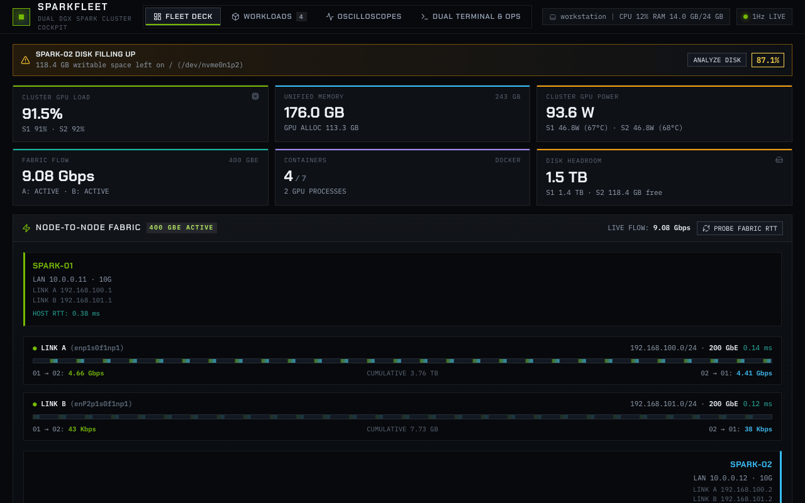

# SparkFleet

A localhost dashboard and control plane for a pair of **NVIDIA DGX Spark** nodes, run from a Mac or Linux workstation over your existing SSH configuration.

Nothing is installed on the nodes. SparkFleet streams a small Python agent to each one over SSH and serves a Bun + React dashboard on `127.0.0.1:7700`.



## Features

- **Live GPU telemetry at 1 Hz:** utilization, clock, power draw, thermal-limit margin, per-sensor temperatures, fan speed and the processes holding GPU memory.
- **Unified memory breakdown:** GPU allocations, host processes, page cache and swap per node.
- **Per-core CPU matrix** with frequency and I/O wait.
- **Node-to-node fabric view:** throughput in each direction, link state and speed for up to two direct links, plus on-demand latency probes between the nodes.
- **Disk pressure alerts** using the same used/available figure as `df`, with a one-click breakdown of home-directory and Docker usage.
- **Docker control:** every container on both nodes, with start, stop, restart and a log viewer, alongside top processes and listening ports.
- **Comparison charts:** a rolling five-minute window of GPU load, power, fabric throughput, temperature, CPU and memory for both nodes.
- **Parallel commands and terminals:** run one command on both nodes with timed output, or work in two interactive SSH terminals and send a line to both at once.

Network interfaces and the root disk are detected on each node: the interface with the default route is treated as the LAN, and other wired interfaces with an address are treated as fabric links.

## Screenshots

| Fleet deck | Workloads |
|---|---|
|  |  |

| Comparison charts | Commands and terminals |
|---|---|
|  |  |

The images show synthetic demo data, not a real cluster.

## Requirements

- [Bun](https://bun.sh) 1.3+ on the workstation (macOS or Linux), along with `ssh` and `ping`
- Key-based SSH access to both nodes, each already present in `known_hosts` (connect once by hand first)
- On the nodes: `python3`, `nvidia-smi`, `docker`, `bash` and the usual Linux tools (`timeout`, `ip`, `ss`, `ps`). All of them ship with DGX OS

## Quick start

1. Install dependencies:
   ```bash
   bun install
   ```

2. Tell SparkFleet which SSH hosts to use. Copy the example and set each `sshHost` to an alias from `~/.ssh/config` (NVIDIA Sync aliases work as they are):
   ```bash
   cp sparkfleet.config.example.json sparkfleet.config.json
   ```
   `sshHost` is the only required field; `label`, `role` and `accent` are cosmetic. The file is gitignored.

   Environment variables override the file:
   ```bash
   SPARK0_HOST=my-spark-1 SPARK1_HOST=my-spark-2 bun run start
   ```

3. Build and start:
   ```bash
   bun run start
   ```
   Open the access link the server prints (`http://127.0.0.1:7700/auth?token=...`). It authorizes that browser until the server restarts.

### Configuration reference

| Setting | Where | Default |
|---|---|---|
| SSH host per node | `nodes.spark-0.sshHost`, `SPARK0_HOST` (and `spark-1`, `SPARK1_HOST`) | `spark-1`, `spark-2` |
| Display label, role | `nodes.*.label`, `nodes.*.role`, `SPARK0_LABEL`, `SPARK0_ROLE` | `SPARK-01`, `RANK 0 · PRIMARY` |
| Port | `port`, `SPARKFLEET_PORT` | `7700` |
| Config file path | `SPARKFLEET_CONFIG` | `./sparkfleet.config.json` |
| Fixed access token | `SPARKFLEET_TOKEN` (24+ characters) | random per launch |

## Development

```bash
bun run dev       # control plane on http://127.0.0.1:7700, restarts on change
bun run dev:web   # Vite dev server on http://127.0.0.1:5173, proxying to :7700
bun run check     # typecheck, lint and tests
```

Open the access link from `bun run dev` once, then use the Vite URL; both share the session cookie. Set `SPARKFLEET_TOKEN` while developing so restarts do not invalidate it.

The agent lives in `server/agent.py` and uses only the Python standard library. To see what a node reports:

```bash
ssh my-spark-1 'timeout 3 python3 -u -' < server/agent.py | tail -1 | jq
```

## Security model

The server can run arbitrary commands on your cluster, so it treats every request as hostile until proven otherwise:

- **Loopback only.** Binds to `127.0.0.1`; it is never reachable from the LAN.
- **Per-launch access token.** Each start generates a random token. The printed link stores it in an `HttpOnly`, `SameSite=Strict` cookie; every API call and WebSocket requires it.
- **Origin and Host allowlist.** Requests whose `Origin` or `Host` is not this server are refused, which blocks other websites in your browser (CSRF, cross-site WebSocket hijacking) and DNS rebinding. No CORS headers are sent.
- **Verified SSH host keys.** Connections use your `known_hosts`; an unknown or changed key fails instead of being accepted.
- **No stored credentials.** Authentication is delegated to your local `ssh` and `~/.ssh/config`.
- **Bounded execution.** Commands are stopped on the node after a time limit (30 seconds for ad-hoc commands, less for built-in actions). Output is capped at 256 KB per stream, with at most 4 concurrent commands per node and 8 open terminals.
- **Redacted process arguments.** Values of flags and variables that look like credentials are masked before process lists reach the browser.
- **No third-party requests.** Fonts and scripts are served locally under a restrictive Content-Security-Policy.

Anyone holding the access link can run commands as your SSH user on both nodes. Treat it like a password.

SparkFleet keeps one multiplexed SSH connection per node open (`~/.ssh/sparkfleet-*` control sockets); they close on their own a minute after the server stops.

## License

MIT
