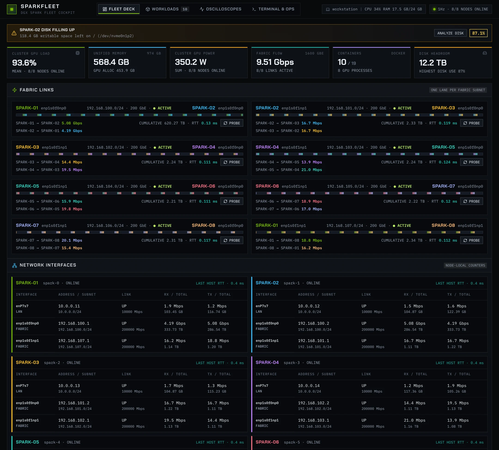
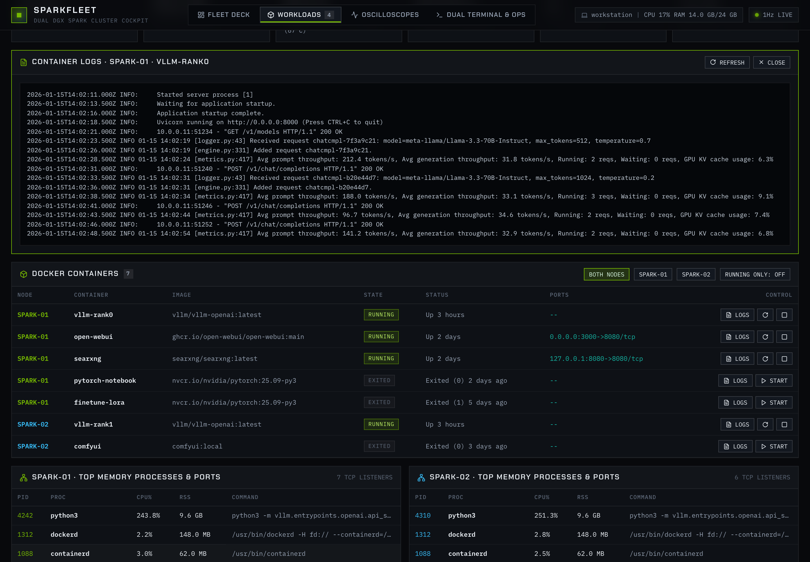
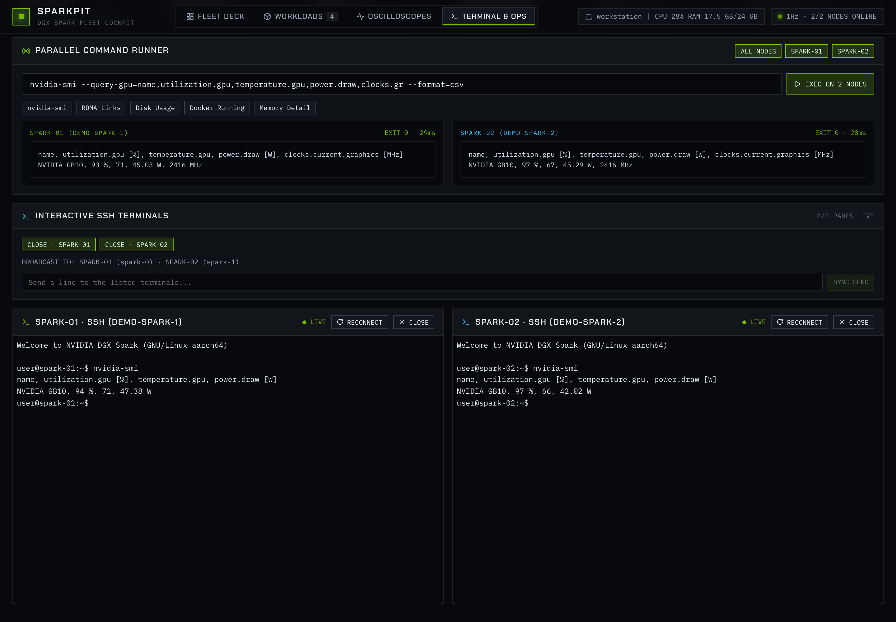

# SparkFleet

A localhost dashboard and control plane for **one to eight NVIDIA DGX Spark nodes**, run from a Mac or Linux workstation over SSH. It connects only to the hosts you configure; there is no network scan.

Nothing is installed on the nodes. SparkFleet streams a small Python agent to each one over SSH and serves a Bun + React dashboard on `127.0.0.1:7700`.


## Features

- **Live GPU telemetry at 1 Hz:** utilization, clock, power draw, thermal-limit margin, per-sensor temperatures, fan speed and the processes holding GPU memory.
- **Unified memory breakdown:** GPU allocations, host processes, page cache and swap per node.
- **Per-core CPU matrix** with frequency and I/O wait.
- **Network interfaces and peer latency:** see RX/TX rates, byte counters, link state and speed per interface. Select a source and target to measure latency over the LAN and any matching fabric subnets.
- **Disk pressure alerts** using the same used/available figure as `df`, with a one-click breakdown of home-directory and Docker usage.
- **Docker control:** view and filter containers by node, read logs, or start, stop and restart a selected container.
- **Comparison charts:** compare a rolling five-minute history of GPU load, power, fabric throughput, temperature, CPU and memory across configured nodes. Offline nodes stay visible but do not contribute to live fleet totals.
- **Commands and terminals:** run a command on selected nodes or the whole fleet. Open SSH from an individual node card, or open several panes and broadcast to those live sessions.

Each node detects its own root disk, LAN (the default route), and up to two addressed wired fabric interfaces. Fabric A/B names are local to each node; the dashboard does not assume a direct cable or attribute an interface's traffic to a specific peer. A single Spark needs no fabric link. Two nodes get one initial peer probe when both are online; larger fleets probe only on request.

## Screenshots



| Fleet deck | Workloads |
|---|---|
|  |  |

| Comparison charts | Commands and terminals |
|---|---|
|  |  |

All visuals use synthetic data. The network panel shows the current eight-node view; the tour and four screenshots below it show an earlier two-node layout.

## Requirements

- [Bun](https://bun.sh) 1.3+ on the workstation (macOS or Linux), along with `ssh` and `ping`
- Key-based SSH access from the workstation to each configured Spark. Connect to each alias once by hand to verify its host key, then check that `ssh -o BatchMode=yes YOUR_ALIAS hostname` works without a prompt.
- On the nodes: `python3`, `nvidia-smi`, `docker`, `bash` and the usual Linux tools (`timeout`, `ip`, `ss`, `ps`). All of them ship with DGX OS

## Quick start

1. Install dependencies:
   ```bash
   bun install
   ```

2. Copy the one-node example and set `sshHost` to that Spark's alias in `~/.ssh/config` (NVIDIA Sync aliases work too):
   ```bash
   cp sparkfleet.config.example.json sparkfleet.config.json
   ```
   Add one entry for each additional Spark under `nodes`. Use distinct keys from `spark-0` through `spark-7`; gaps are fine. For example, a two-Spark config is:

   ```json
   {
     "nodes": {
       "spark-0": { "sshHost": "my-spark-1" },
       "spark-1": { "sshHost": "my-spark-2" }
     }
   }
   ```

   For eight Sparks, add six more entries through `"spark-7": { "sshHost": "my-spark-8" }`. For one, keep just the first entry. No count setting or code change is needed. Existing two-node configs keep their IDs and labels. Restart SparkFleet after editing. Keep your real aliases in the gitignored `sparkfleet.config.json`.

   Alternatively, skip the config file and list the hosts in your environment:
   ```bash
   SPARK0_HOST=my-spark-1 SPARK1_HOST=my-spark-2 bun run start
   ```
   If the file already lists `nodes`, its membership is authoritative: `SPARKn_HOST` can override a listed host, not add an unlisted one. With no configured hosts SparkFleet prints a setup error instead of trying guessed aliases.

3. Build and start:
   ```bash
   bun run start
   ```
   Open the access link the server prints (`http://127.0.0.1:7700/auth?token=...`). It authorizes that browser until the server restarts.

### Configuration reference

| Setting | Where | Default |
|---|---|---|
| SSH destination | `nodes.spark-N.sshHost` or `SPARKN_HOST` (`N` = `0`…`7`) | None; configure one distinct SSH destination per Spark |
| Display label, role | `nodes.spark-N.label`, `.role` or `SPARKN_LABEL`, `SPARKN_ROLE` | `SPARK-01`…`SPARK-08`, `DGX SPARK` |
| Display color | `nodes.spark-N.accent` (`#RRGGBB`) | One color per slot |
| Port | `port`, `SPARKFLEET_PORT` | `7700` |
| Config file path | `SPARKFLEET_CONFIG` | `./sparkfleet.config.json` |
| Fixed access token | `SPARKFLEET_TOKEN` (24+ characters) | random per launch |

## Development

```bash
bun run dev       # control plane on http://127.0.0.1:7700, restarts on change
bun run dev:web   # Vite dev server on http://127.0.0.1:5173, proxying to :7700
bun run check     # typecheck, lint and tests
```

Open the access link from `bun run dev` once, then use the Vite URL; both share the session cookie. Set `SPARKFLEET_TOKEN` while developing so restarts do not invalidate it.

The agent lives in `server/agent.py` and uses only the Python standard library. To see what a node reports:

```bash
ssh my-spark-1 'timeout 3 python3 -u -' < server/agent.py | tail -1 | jq
```

## Security model

The server can run arbitrary commands on your cluster, so it treats every request as hostile until proven otherwise:

- **Loopback only.** Binds to `127.0.0.1`; it is never reachable from the LAN.
- **Per-launch access token.** Each start generates a random token. The printed link stores it in an `HttpOnly`, `SameSite=Strict` cookie; every API call and WebSocket requires it.
- **Origin and Host allowlist.** Requests whose `Origin` or `Host` is not this server are refused, which blocks other websites in your browser (CSRF, cross-site WebSocket hijacking) and DNS rebinding. No CORS headers are sent.
- **Verified SSH host keys.** Connections use your `known_hosts`; an unknown or changed key fails instead of being accepted.
- **No stored credentials.** Authentication is delegated to your local `ssh` and `~/.ssh/config`.
- **Bounded execution.** Commands are stopped on the node after a time limit (30 seconds for ad-hoc commands, less for built-in actions). Output is capped at 256 KB per stream, with at most 4 concurrent commands per node and 8 open terminals.
- **Redacted process arguments.** Values of flags and variables that look like credentials are masked before process lists reach the browser.
- **No third-party requests.** Fonts and scripts are served locally under a restrictive Content-Security-Policy.

Anyone holding the access link can run commands as your SSH user on every configured node. Treat it like a password.

SparkFleet keeps one multiplexed SSH connection per node open (`~/.ssh/sparkfleet-*` control sockets); they close on their own a minute after the server stops.

## License

MIT
